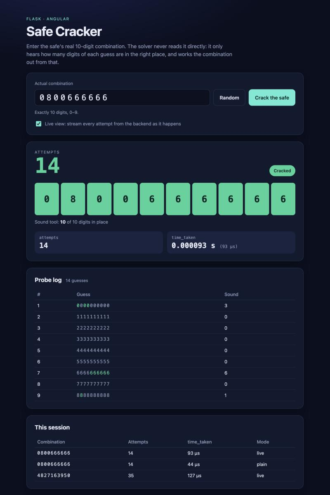

# Safe Cracker

A full-stack application around the `crack_safe` solver from Part 1.
The backend is a Flask API that cracks a 10-digit combination safe using only
the "sound tool" feedback (how many positions of a guess are right); the
frontend is an Angular app with a form to submit the real combination and a
live view that shows the crack happening one attempt at a time.



## What's inside

```
backend/
  cracker.py     Part 1 solver (crack_safe) – unchanged except for an optional on_guess hook
  app.py         Flask app: /api/crack_safe/, /api/crack_safe/stream/, serves the built UI
frontend/        Angular 21 app (source in src/app/, production build committed in dist/)
tests/           pytest suite for the solver and the API
Dockerfile       multi-stage build: Node builds the UI, Python serves everything
```

## Run it (Python only)

The production build of the frontend is committed in `frontend/dist/`, so the
whole app runs with just Python 3.10+:

```bash
python3 -m venv .venv && source .venv/bin/activate
pip install -r requirements.txt
python -m backend.app
```

Then open <http://localhost:8000>. `PORT` and `HOST` environment variables
override the defaults (`8000`, `127.0.0.1`).

## API

### `POST /api/crack_safe/`

Runs `crack_safe` on the given combination and returns its two outputs.

```bash
curl -s -X POST http://localhost:8000/api/crack_safe/ \
  -H 'Content-Type: application/json' \
  -d '{"actual_combination": "0800666666"}'
```

```json
{"attempts": 14, "time_taken": 4.5e-05}
```

`attempts` is the number of times the sound tool was used; `time_taken` is the
wall-clock time of the solver in seconds (`time.perf_counter`).

Invalid input returns `400` with `{"error": "<reason>"}`: a body that is not a
JSON object, a missing `actual_combination`, a non-string value, or a value
that is not exactly 10 ASCII digits.

### `POST /api/crack_safe/stream/`

Same input, but the response is a stream (`application/x-ndjson`, one JSON
object per line) with one `attempt` event per sound-tool call and a final
`done` event that carries the same two fields as `/api/crack_safe/`. The UI
uses this for the live attempt counter.

```bash
curl -sN -X POST http://localhost:8000/api/crack_safe/stream/ \
  -H 'Content-Type: application/json' \
  -d '{"actual_combination": "0800666666", "pace_ms": 40}'
```

```
{"event": "attempt", "attempt": 1, "guess": "0000000000", "matches": 2}
{"event": "attempt", "attempt": 2, "guess": "1111111111", "matches": 0}
...
{"event": "attempt", "attempt": 13, "guess": "6660666666", "matches": 7}
{"event": "attempt", "attempt": 14, "guess": "0800666666", "matches": 10}
{"event": "done", "attempts": 14, "time_taken": 4.5e-05}
```

`pace_ms` (optional, 0–1000, default 40) is the delay between lines; the UI asks for
80 ms so that each beep of the sound tool can be heard. The solver
itself runs unthrottled in a worker thread, so `time_taken` is its real
duration; the pacing only spreads delivery out so a person can watch.

### `GET /api/health/`

Returns `{"status": "ok"}`.

## Frontend

The UI lives in `frontend/` (Angular 21, standalone components, signals,
zoneless). The relevant files are:

- `src/app/app.ts` – the page component: the form, the live counter, results and history
- `src/app/app.html` / `app.css` – its template and styles
- `src/app/crack-safe.service.ts` – the two API calls (plain POST, and the NDJSON stream)
- `src/app/sound.service.ts` – the audible sound tool: Web Audio beeps per probe and the success jingle

To work on it you need Node 22+:

```bash
cd frontend
npm install
npm start          # dev server on http://localhost:4200, /api is proxied to Flask on :8000
npm run build      # production build into frontend/dist/, which Flask serves
```

Run `python -m backend.app` in another terminal while using the dev server.

`npm ci` (or `npm install` with the committed `package-lock.json`) works with the
npm bundled in Node 22. Installing *without* the lock file trips a bug in npm
10.9 (`Cannot read properties of null (reading 'edgesOut')`); upgrading npm with
`npm install -g npm@latest` fixes that.

## Tests

```bash
pip install -r requirements-dev.txt
pytest
```

The suite covers the solver (edge cases, 300 random combinations, invalid input,
and that the `on_guess` hook does not change results) and the API (response
shape, validation errors, JSON errors for wrong method / unknown route, and the
stream's event sequence matching the plain endpoint).

## Docker

```bash
docker build -t safe-cracker .
docker run --rm -p 8000:8000 safe-cracker
```

The image builds the frontend in a Node stage and serves everything from a
Python stage with gunicorn.

## How the solver works

The sound tool reports how many positions of a guess match the real
combination. The solver first probes `0000000000`, `1111111111`, … to learn how
many times each digit occurs (the count for `9` is implied, and the loop stops
early once all 10 positions are accounted for). It then takes the most frequent
digit `b` as a baseline: the all-`b` guess has a known score, so changing one
position to another digit `d` moves the score by exactly +1 (that position is
`d`), −1 (that position is `b`) or 0 (it is neither, so both are ruled out).
Candidates for each position are limited to digits that still have remaining
occurrences and are probed most-frequent first, and the final guess verifies
the result. Over 5,000 random combinations this takes between 16 and 42
attempts (mean 25.1) and about 25 µs.

## Design notes

- **Live view.** The solver finishes in tens of microseconds, far too fast to
  watch. The stream endpoint runs it in a worker thread, forwards every probe
  through the solver's `on_guess` hook, and paces delivery; the frontend
  updates its counter per event and freezes it on `done`.
- **The sound tool makes sound.** Every probe plays a short beep whose pitch
  rises with the number of digits in place (0 → A3, two semitones per digit),
  and opening the safe plays a short jingle; a failed request buzzes. All of it
  is synthesised with the Web Audio API, so there are no audio files. The
  mute switch next to the status badge is remembered in `localStorage`, and
  visitors whose OS asks for reduced motion get a page without transitions
  and start muted. The jingle is the `SUCCESS_MELODY` note list at the top of
  `frontend/src/app/sound.service.ts`.
- **Part 1 stays intact.** The only change to `crack_safe` is the optional
  `on_guess(guess, matches)` callback (default `None`), which leaves the
  submitted behaviour unchanged.
- **Stricter validation at the edge.** The API accepts only ASCII digits
  (`^[0-9]{10}$`); `str.isdigit()` would also accept other Unicode digits that
  the solver can never produce.
- **Static files never shadow the API.** The built frontend is served from a
  path route that excludes `/api`, so wrong-method or unknown API calls get
  JSON 404/405 responses instead of a file lookup.
